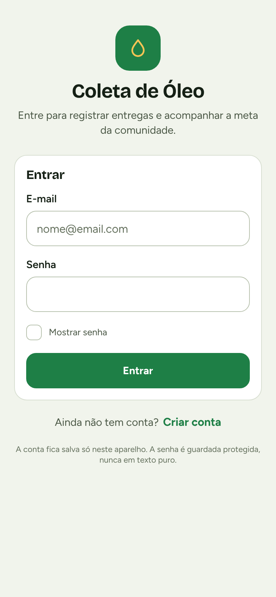
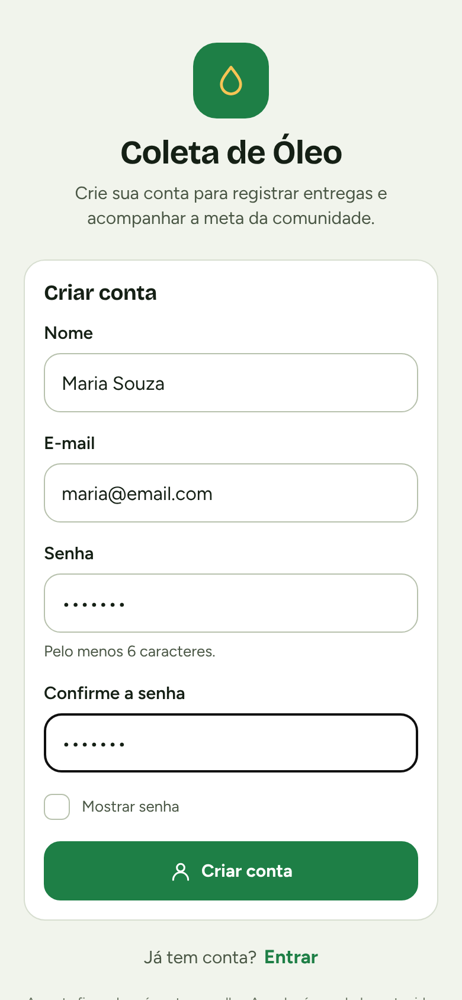
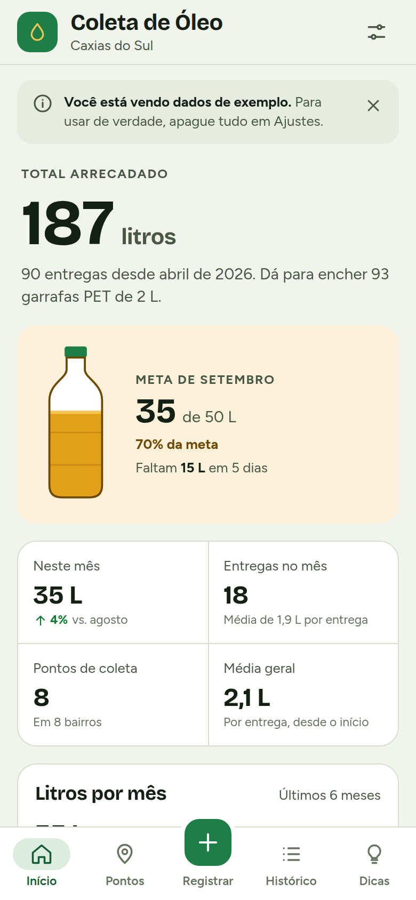
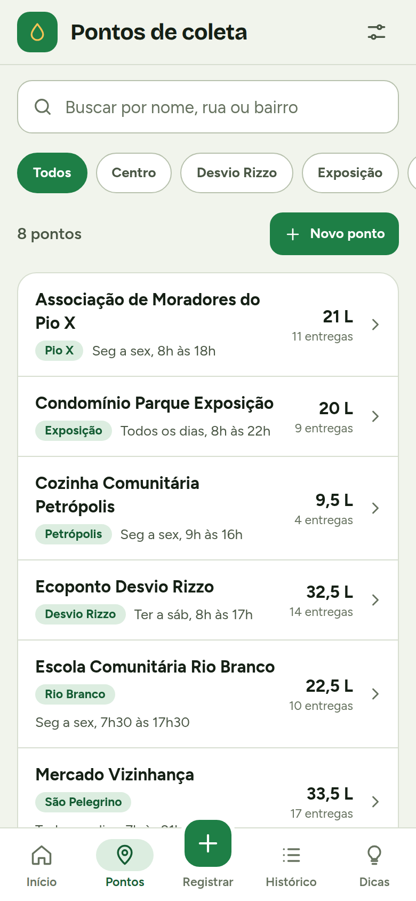
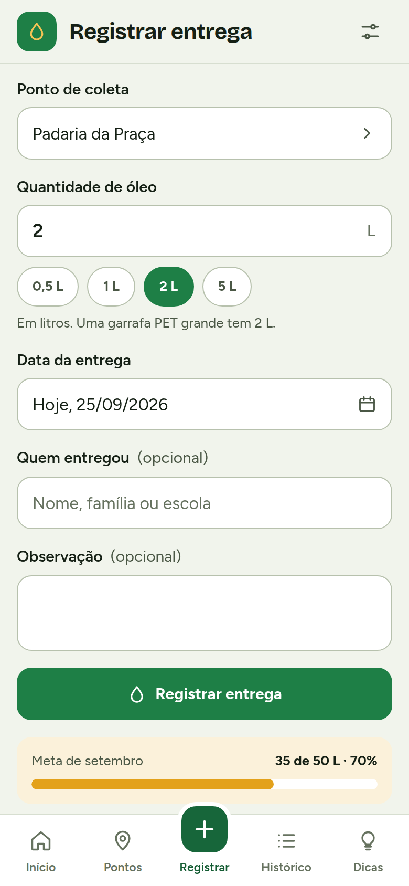
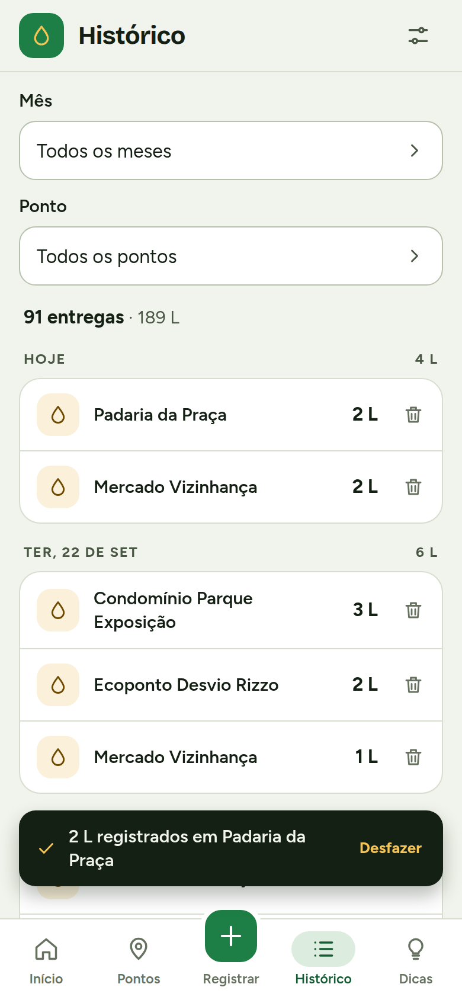
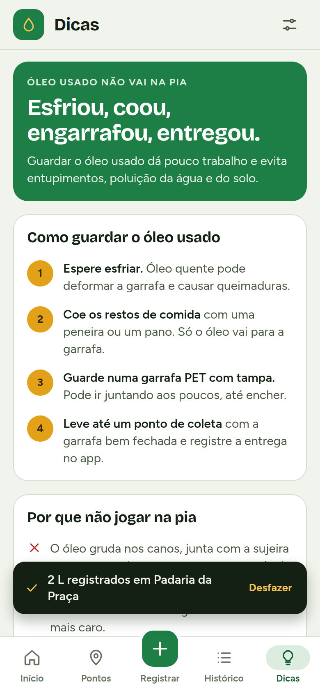
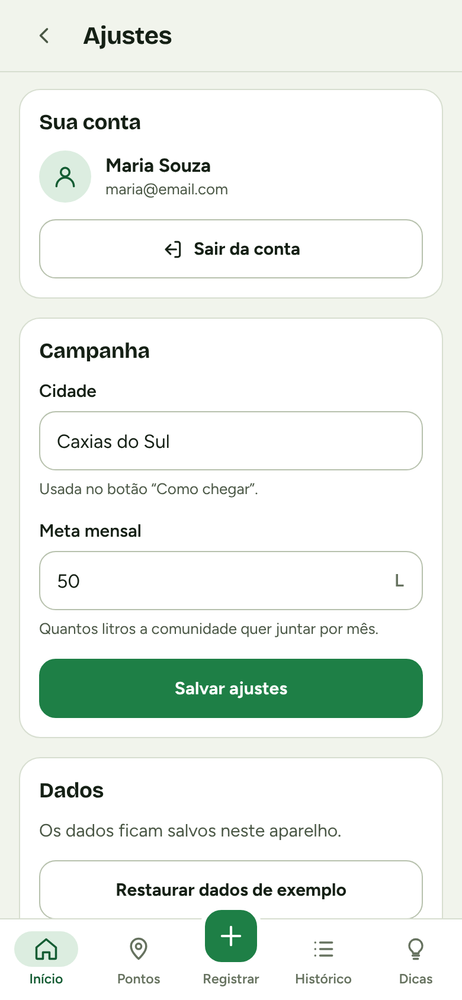

# Coleta de Óleo Usado — aplicativo mobile

Aplicativo em **React Native (Expo)** que reúne os pontos de coleta de óleo de cozinha usado da cidade e mostra quanto a comunidade já arrecadou, com meta mensal, gráficos e dicas de descarte correto.

Projeto final da disciplina de Programação para Dispositivos Móveis.

| Entrar | Criar conta | Início | Pontos |
|---|---|---|---|
|  |  |  |  |

| Registrar | Histórico | Dicas | Ajustes |
|---|---|---|---|
|  |  |  |  |

📐 **Modelagem do sistema** (requisitos, casos de uso, modelo de dados, fluxo de telas e arquitetura): [docs/modelagem.md](docs/modelagem.md)

---

## Como rodar

Pré-requisitos: [Node.js](https://nodejs.org) 20 ou mais novo no computador e o app **Expo Go** no celular (grátis, na App Store ou na Play Store).

O projeto usa o **Expo SDK 58** (React Native 0.88). O Expo Go da loja roda só a versão mais nova do SDK. Se aparecer "Project is incompatible with this version of Expo Go", o projeto precisa ser atualizado com `npx expo install expo@latest --fix`.

```bash
npm install        # só na primeira vez
npx expo start     # inicia o projeto e mostra um QR Code
```

- **iPhone:** abra a câmera, aponte para o QR Code e toque na notificação. O app abre dentro do Expo Go.
- **Android:** abra o Expo Go e use "Scan QR code".

O computador e o celular precisam estar na mesma rede. Se a rede bloquear (Wi-Fi de faculdade costuma bloquear), use:

```bash
npm run tunel       # é o mesmo que: npx expo start --tunnel ngrok
```

> No SDK 58, o `--tunnel` sozinho usa o túnel da Expo, que exige estar logado (`npx expo login`). Com `ngrok` não precisa de conta — por isso o atalho `npm run tunel` já usa ele.

O modo túnel passa pela internet, então funciona mesmo em redes diferentes — inclusive com o computador conectado no seu roteador de bolso (hotspot do celular).

### Outros comandos

```bash
npm test           # roda os 60 testes automáticos
npx expo start -c  # inicia limpando o cache (quando algo estranho acontecer)
```

---

## No dia da apresentação (iPhone, com o PC ficando em casa)

O Expo Go precisa do projeto rodando em algum computador — **mas esse computador não precisa estar com você**. Com o modo túnel, o PC de casa fica servindo o app pela internet e o celular acessa de qualquer lugar, usando 4G.

**Plano A — PC de casa ligado, celular no 4G**

1. **Na véspera**, no PC de casa: `npm run tunel` (é o `expo start --tunnel ngrok`). Na primeira vez ele pode pedir para instalar o `@expo/ngrok` — aceite.
2. No terminal aparece um endereço parecido com `exp://algo-anonymous-8081.exp.direct`. **Anote esse endereço** (manda pra ti mesmo no WhatsApp).
3. Ainda em casa, abra o app no celular pelo QR Code, **crie sua conta** (ela fica salva no celular, então na hora da apresentação o app já abre logado) e confira se está tudo certo.
4. **Desligue a suspensão automática do PC:** Configurações → Sistema → Energia → "Tela e suspensão" → Suspensão: Nunca. Deixe o terminal aberto e o PC ligado.
5. **Na faculdade**, com o celular no 4G: abra o Expo Go → aba Home → o projeto aparece em "Recently opened"; se não aparecer, toque em "Enter URL manually" e cole aquele endereço.
6. Depois que o app carregar, **não feche o Expo Go**. Se a internet oscilar, ele continua rodando.

Detalhe importante: o endereço muda toda vez que o servidor é reiniciado. Por isso, uma vez ligado, deixe rodando até a apresentação acabar. Vale instalar um acesso remoto (AnyDesk ou Chrome Remote Desktop) no PC e no celular, para religar o comando de longe se precisar.

**Plano B — sem depender do PC**

A versão web do mesmo app (a que está no Netlify) abre no Safari e pode ser adicionada à tela inicial do iPhone, ficando com ícone e em tela cheia. É idêntica visualmente e não depende de nada ligado em casa.

**Plano C — o seguro**

Grave um vídeo da tela do celular usando o app (30 a 60 segundos, passando por Início, Pontos, Registrar e Histórico). Se a internet falhar de vez, você apresenta o vídeo e explica o código.

> Instalar o app "de verdade" no iPhone (sem Expo Go) exige uma conta paga de desenvolvedor da Apple. No Android, dá para gerar um APK grátis com `eas build -p android --profile preview` e instalar direto no aparelho — o arquivo `eas.json` já está no projeto.

---

## O que o app faz

**Entrar / Criar conta** — na primeira vez, a pessoa cria uma conta com nome, e-mail e senha (com confirmação). Nas próximas, entra com e-mail e senha. O app valida os campos, não deixa repetir e-mail e lembra quem está logado, então não precisa digitar a senha toda vez. A senha **nunca é salva**: o app guarda só um hash SHA-256 com sal (veja abaixo).

**Início** — total arrecadado, meta do mês numa garrafa que enche conforme o progresso, comparação com o mesmo período do mês anterior, gráfico dos últimos 6 meses (toque numa coluna para ver o detalhe, ou veja como tabela), ranking dos pontos e últimas entregas.

**Pontos de coleta** — busca que ignora acentos, filtro por bairro, detalhe de cada ponto com gráfico próprio e botão **Como chegar**, que abre o endereço no app de mapas. Cadastro, edição e exclusão, com opção de desfazer.

**Registrar entrega** — ponto, quantidade em litros (aceita vírgula e tem atalhos de 0,5 / 1 / 2 / 5 L), data num calendário próprio e quem entregou. Valida os campos e mostra mensagens claras. Dá para desfazer logo depois.

**Histórico** — entregas agrupadas por dia, com filtro por mês e por ponto, exclusão com desfazer.

**Dicas** — como guardar o óleo, por que não jogar na pia, no que ele se transforma e o que não misturar.

**Ajustes** — dados da conta e botão **Sair**, cidade, meta mensal, restaurar os dados de exemplo ou apagar tudo.

O app segue o tema claro ou escuro do celular e funciona sem internet: os dados ficam salvos no próprio aparelho.

### Como a senha é protegida

Quando alguém cria a conta, o app gera um **sal** aleatório e calcula o **SHA-256** de sal + senha, repetindo o cálculo 1.000 vezes. Só o sal e o resultado (o hash) vão para o AsyncStorage. No login, o app refaz a conta com a senha digitada e compara com o hash salvo. Assim, mesmo quem abrir o armazenamento do aparelho não vê a senha.

O SHA-256 foi escrito em JavaScript puro (`src/utils/senha.js`), sem biblioteca nativa, para o app continuar rodando no Expo Go. Os testes conferem o resultado com os valores oficiais do algoritmo.

> Como não há servidor, a conta vale só para o aparelho onde foi criada. Numa versão com backend, o login passaria para uma API (ou Firebase Auth) e os dados seriam sincronizados entre aparelhos.

---

## Estrutura do projeto

```
App.js                        # Carrega as fontes e monta os "providers"
app.json                      # Configuração do Expo (nome, ícone, splash)
src/
├── Aplicativo.jsx            # Topo, barra de abas e escolha da tela
├── tema.js                   # Cores dos temas claro/escuro e tipografia
├── context/
│   ├── AutenticacaoContext.jsx # Contas, login, sessão e sair
│   ├── DadosContext.jsx      # Dados do app + salvamento no aparelho
│   └── dadosReducer.js       # Todas as alterações nos dados (useReducer)
├── navegacao/
│   ├── NavegacaoContext.jsx  # Pilha de telas + botão voltar do Android
│   ├── Topo.jsx              # Barra de cima
│   └── BarraAbas.jsx         # Barra de abas de baixo
├── telas/                    # Acesso (entrar/criar conta), Inicio, Pontos,
│                             # PontoDetalhe, PontoForm, Registrar,
│                             # Historico, Dicas, Ajustes
├── componentes/              # Peças reutilizáveis:
│   ├── GraficoColunas.jsx    # Gráfico de colunas (só com Views)
│   ├── GraficoBarras.jsx     # Ranking em barras
│   ├── MedidorGarrafa.jsx    # Garrafa da meta (react-native-svg)
│   ├── SeletorModal.jsx      # Lista de opções em janela
│   ├── SeletorData.jsx       # Calendário próprio
│   └── Botao, Campo, Chip, Painel, Blocos, Texto, Icone, Toast,
│       Confirmacao, ListaEntregas, Vazio, Tela
└── utils/                    # Funções puras (fáceis de testar)
    ├── estatisticas.js       # Cálculos do painel
    ├── validacao.js          # Regras dos formulários (inclui cadastro e login)
    ├── senha.js              # SHA-256 + sal para proteger a senha
    ├── armazenamento.js      # AsyncStorage com plano B na memória
    └── datas.js, formatar.js, escala.js, id.js, dadosExemplo.js
__tests__/                    # Testes automáticos (Jest + Testing Library)
docs/
├── modelagem.md              # Requisitos, casos de uso, dados, telas, arquitetura
└── prints/                   # Prints das telas
```

### Bibliotecas usadas

Só o essencial, tudo já incluído no Expo Go:

- `react-native-svg` — a garrafa da meta e os ícones
- `@react-native-async-storage/async-storage` — salvar os dados no aparelho
- `react-native-safe-area-context` — respeitar o notch e a barra de baixo do iPhone
- `expo-font` + `@expo-google-fonts/*` — as fontes Figtree e Bricolage Grotesque

A navegação, os gráficos, o calendário e as janelas de seleção foram feitos à mão, sem biblioteca — por isso o app é leve e não depende de código nativo extra.

---

## Conceitos de React Native usados

- **Componentes e props** em todas as telas e peças da interface
- **useState** nos formulários e filtros
- **useReducer + Context** para os dados do app (`useDados()` em qualquer tela)
- **Context** para a conta logada (`useAutenticacao()`), com renderização condicional: sem usuário, o app mostra a tela de acesso
- **useEffect** para carregar e salvar no AsyncStorage (dados, contas e sessão)
- **TextInput** com `secureTextEntry`, teclado de e-mail e preenchimento automático de senha
- **Hook próprio** (`useNavegacao`) com pilha de telas e suporte ao botão voltar do Android
- **StyleSheet** com tema claro/escuro (`useColorScheme`)
- **Pressable, Modal, ScrollView, Animated** (a animação do aviso na tela)
- **Acessibilidade**: `accessibilityLabel`, `accessibilityRole` e leitura dos gráficos como tabela

---

## Testes

`npm test` roda 60 testes que cobrem:

- cálculos do painel (somas, média, litros por mês, ranking, comparação com o mês anterior e meta)
- validação dos formulários, incluindo cadastro e login
- o SHA-256 (comparado com os valores oficiais) e a conferência de senha com sal
- datas, formatação em português e escala dos gráficos
- salvamento no aparelho, inclusive quando o armazenamento falha
- fluxos completos na interface: criar conta, entrar, senha errada, e-mail repetido, sair, navegar entre as abas, registrar entrega, desfazer, cadastrar ponto, excluir entrega e mudar a meta

---

## Dados de exemplo

Na primeira vez que o app abre, ele pede para criar uma conta e depois carrega **8 pontos fictícios em bairros de Caxias do Sul** e cerca de 6 meses de entregas, para a apresentação não começar vazia. Um aviso no topo do Início deixa isso claro.

- Para usar de verdade: **Ajustes → Apagar todos os dados**
- Para trocar pelos pontos reais: edite `src/utils/dadosExemplo.js`
- Para mudar cidade e meta: **Ajustes**

---

Desenvolvido por Gabriel Breda.
