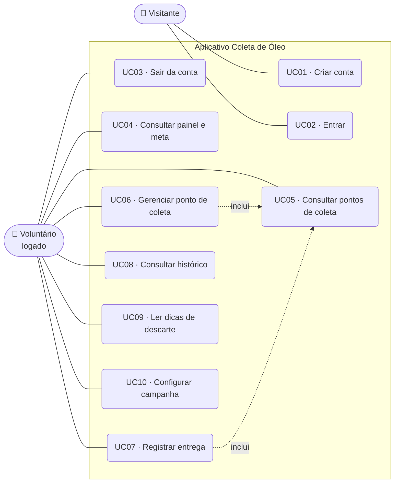
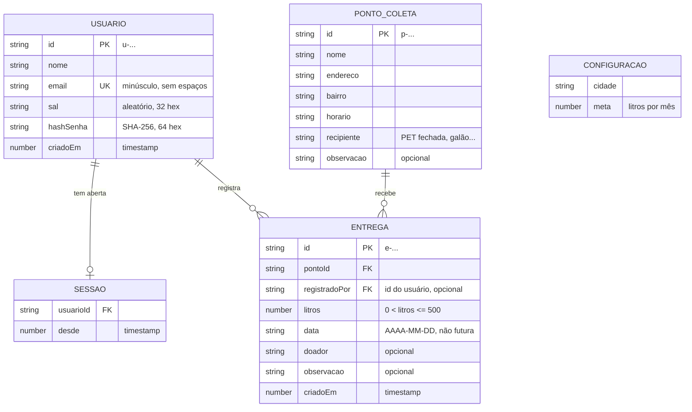
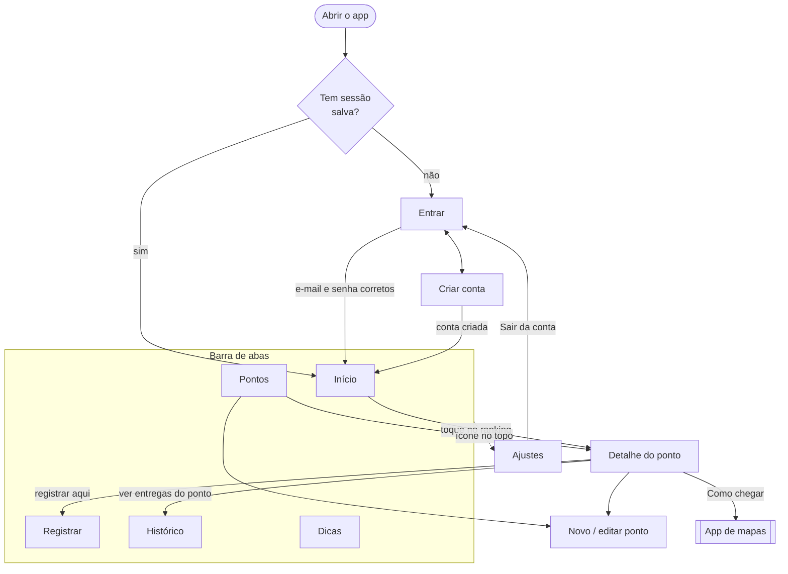
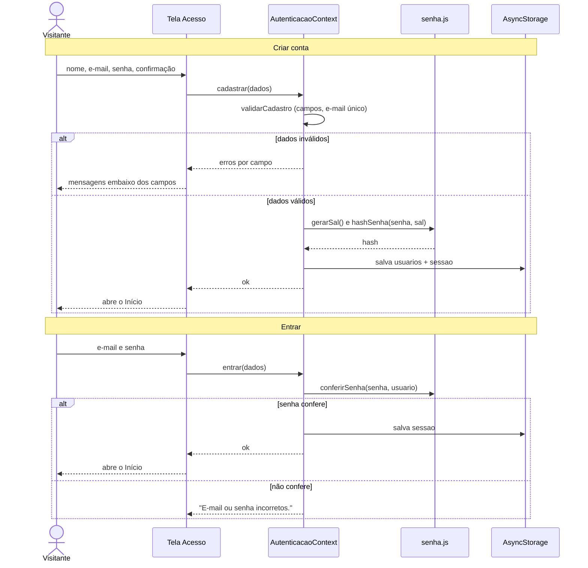
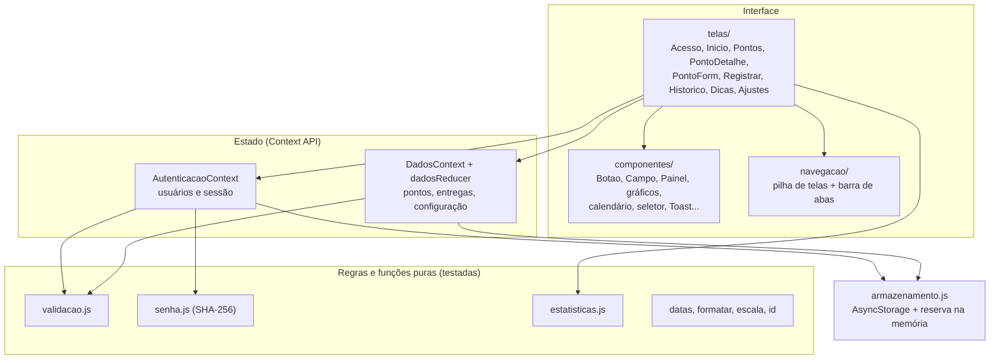

# Modelagem do sistema — Coleta de Óleo Usado

Este documento descreve o aplicativo do ponto de vista de análise: quem usa, o que cada um faz, quais dados existem, como as telas se ligam e como o código está organizado. Os diagramas estão em [Mermaid](https://mermaid.js.org) e aparecem desenhados direto no GitHub.

1. [Visão geral](#1-visão-geral)
2. [Requisitos](#2-requisitos)
3. [Casos de uso](#3-casos-de-uso)
4. [Modelo de dados](#4-modelo-de-dados)
5. [Fluxo de telas](#5-fluxo-de-telas)
6. [Sequência: cadastro e login](#6-sequência-cadastro-e-login)
7. [Arquitetura](#7-arquitetura)

---

## 1. Visão geral

**Problema.** O óleo de cozinha jogado na pia entope canos e contamina a água. Muita gente até guarda o óleo usado, mas não sabe onde entregar, e quem organiza a coleta não tem um jeito fácil de mostrar o resultado para a comunidade.

**Solução.** Um app que reúne os pontos de coleta da cidade, registra cada entrega em litros e mostra o total arrecadado, a meta do mês e a evolução nos últimos meses. Também traz dicas de como guardar e descartar o óleo.

**Escopo desta versão.** Funciona sem internet: contas, pontos e entregas ficam salvos no próprio aparelho (AsyncStorage). Não há servidor.

---

## 2. Requisitos

### Funcionais

| Código | Requisito |
|---|---|
| RF01 | Criar conta com nome, e-mail e senha |
| RF02 | Entrar com e-mail e senha, e sair da conta |
| RF03 | Manter a pessoa logada ao reabrir o app |
| RF04 | Listar pontos de coleta com busca (ignorando acentos) e filtro por bairro |
| RF05 | Cadastrar, editar e excluir pontos de coleta, com opção de desfazer a exclusão |
| RF06 | Abrir o endereço do ponto no app de mapas ("Como chegar") |
| RF07 | Registrar entrega de óleo: ponto, litros, data e quem entregou |
| RF08 | Ver o histórico de entregas por dia, com filtro por mês e por ponto, e excluir com desfazer |
| RF09 | Mostrar painel com total arrecadado, meta do mês, comparação com o mês anterior, gráfico dos últimos 6 meses e ranking dos pontos |
| RF10 | Mostrar dicas de armazenamento e descarte |
| RF11 | Configurar cidade e meta mensal; restaurar dados de exemplo ou apagar tudo |

### Não funcionais

| Código | Requisito |
|---|---|
| RNF01 | Rodar em Android e iOS pelo Expo Go, sem código nativo extra |
| RNF02 | Funcionar sem internet, com os dados salvos no aparelho |
| RNF03 | Nunca guardar a senha em texto puro: só um hash SHA-256 com sal |
| RNF04 | Seguir o tema claro ou escuro do celular |
| RNF05 | Acessibilidade: rótulos nos controles e gráficos também legíveis como tabela |
| RNF06 | Validar formulários com mensagens claras em português |

---

## 3. Casos de uso

O app tem um ator principal, o **Voluntário** (quem organiza ou ajuda na coleta). Antes de entrar, ele é um **Visitante**, que só pode criar conta ou fazer login.

| Caso de uso | Descrição resumida |
|---|---|
| UC01 · Criar conta | O visitante informa nome, e-mail e senha (com confirmação). O app valida, impede e-mail repetido, guarda a senha protegida e já entra. |
| UC02 · Entrar | O visitante informa e-mail e senha. Se baterem, a sessão é aberta e fica salva. Se não, aparece "E-mail ou senha incorretos." |
| UC03 · Sair da conta | Em Ajustes, o voluntário confirma a saída e volta para a tela de entrar. Os dados de coleta continuam no aparelho. |
| UC04 · Consultar painel | Mostra total arrecadado, garrafa da meta do mês, comparação com o mês anterior, gráfico de 6 meses e ranking. |
| UC05 · Consultar pontos | Lista com busca e filtro por bairro; o detalhe mostra endereço, horário, gráfico do ponto e "Como chegar". |
| UC06 · Gerenciar ponto | Cadastrar, editar ou excluir um ponto. Excluir também remove as entregas dele, com opção de desfazer. |
| UC07 · Registrar entrega | Escolhe o ponto, informa litros (aceita vírgula), data e quem entregou. A entrega fica ligada ao usuário logado. |
| UC08 · Consultar histórico | Entregas agrupadas por dia, com filtros e exclusão com desfazer. |
| UC09 · Ler dicas | Conteúdo fixo sobre como guardar, por que não jogar na pia e o que não misturar. |
| UC10 · Configurar campanha | Altera cidade e meta mensal; restaura os dados de exemplo ou apaga tudo. |

---

## 4. Modelo de dados

Os dados ficam em três chaves do AsyncStorage, todas em JSON:

| Chave | Conteúdo |
|---|---|
| `coleta-oleo:usuarios` | Lista de usuários (contas) |
| `coleta-oleo:sessao` | Quem está logado agora (`usuarioId`) |
| `coleta-oleo:v1` | Pontos, entregas, configuração da campanha e o aviso de dados de exemplo |

**Regras de negócio**

- O e-mail é único: a comparação ignora maiúsculas e espaços nas pontas.
- A senha tem no mínimo 6 caracteres e nunca é salva. O app guarda um sal aleatório e o resultado de 1.000 rodadas de SHA-256 sobre sal + senha.
- No login, e-mail inexistente e senha errada mostram a mesma mensagem, para não revelar quais e-mails têm conta.
- Toda entrega pertence a um ponto. Excluir um ponto exclui as entregas dele (e o desfazer devolve tudo).
- Quantidade de uma entrega: maior que zero e até 500 L. Data: obrigatória e não pode ser no futuro.
- `registradoPor` é opcional porque as entregas de exemplo (e as feitas antes do login existir) não têm autor.
- A configuração da campanha é única por aparelho (não é um registro por usuário).

---

## 5. Fluxo de telas

---

## 6. Sequência: cadastro e login

---

## 7. Arquitetura

O app é organizado em camadas. As telas não acessam o armazenamento diretamente: pedem tudo aos contextos, que concentram as regras e salvam no aparelho.

**Tecnologias:** React Native 0.86 com Expo SDK 57, React 19, Context API + `useReducer`, AsyncStorage, `react-native-svg`, Jest + Testing Library. Detalhes no [README](../README.md#bibliotecas-usadas).
